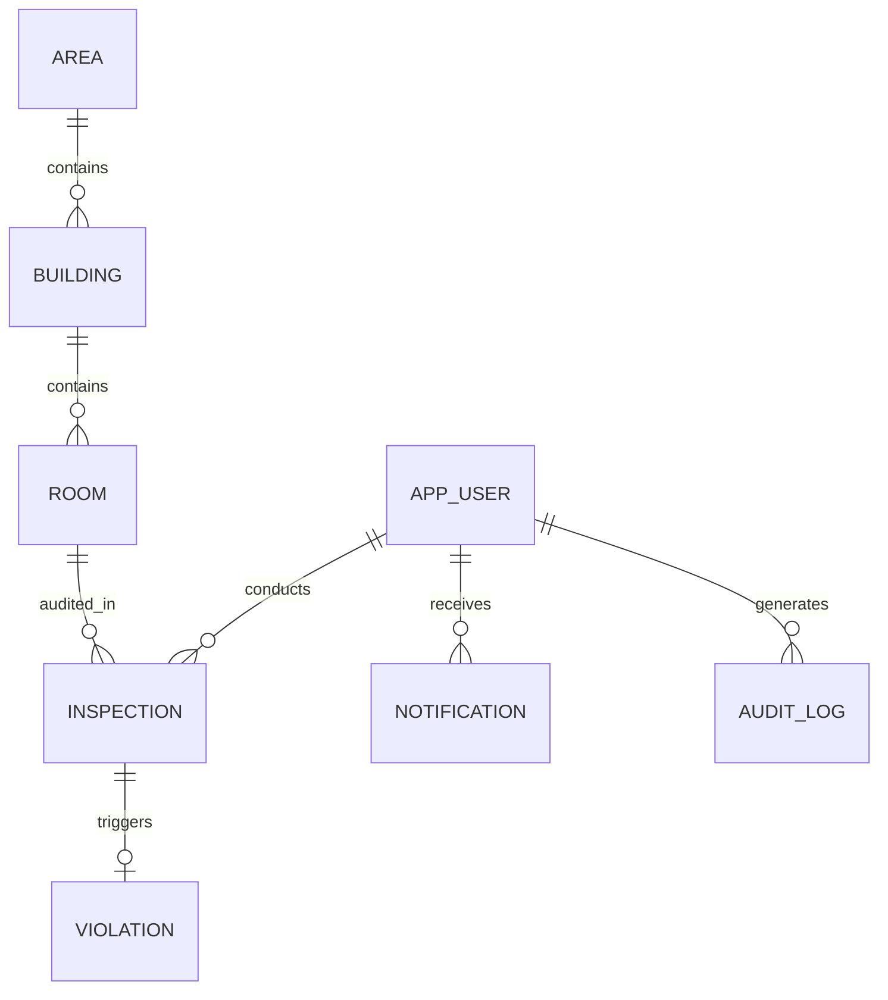

# WasteWatch — Database Design & Schema Specification

> **STATUS: FULLY IMPLEMENTED IN RUNTIME (PHASES 1–14)**  
> *The relational schema, JPA entities, repositories, and constraints described below are actively running in `com.wastewatch.entity` and `com.wastewatch.repository`, initialized and auto-seeded upon application startup.*

---

## 1. Overview & Portability Strategy

WasteWatch uses a clean relational database schema managed through Spring Data JPA and Hibernate.
- **Development & Demonstration Target**: In-memory H2 Database (`jdbc:h2:mem:wastewatchdb`) for zero-friction setup and deterministic evaluation.
- **Production & SaaS Target**: PostgreSQL 15+ (or MySQL 8+).
- **Portability Rules**:
  - Strictly use ANSI-standard SQL column types and JPA annotations.
  - Avoid proprietary database-specific triggers or stored procedures.
  - Table name `APP_USERS` is used instead of `USERS` to avoid SQL reserved keyword conflicts across PostgreSQL, H2, and Oracle.
  - Explicit composite unique constraints on `(building_id, room_number)` and `(inspection_id)`.

---

## 2. Entity-Relationship (ER) Model

---

## 3. Runtime Table Specifications

### 3.1. `APP_USERS`
* **Purpose**: User accounts, credentials, and role assignments.
* **Fields**:
  | Column Name | Data Type | Constraints | Description |
  | :--- | :--- | :--- | :--- |
  | `id` | `BIGINT` | `PRIMARY KEY, AUTO_INCREMENT` | Unique user identifier |
  | `username` | `VARCHAR(50)` | `NOT NULL, UNIQUE` | Login username |
  | `email` | `VARCHAR(100)`| `NOT NULL, UNIQUE` | User email address |
  | `password_hash` | `VARCHAR(255)`| `NOT NULL` | BCrypt encrypted password |
  | `full_name` | `VARCHAR(100)`| `NOT NULL` | Full display name |
  | `phone_number` | `VARCHAR(20)` | `NULLABLE` | Contact telephone number |
  | `role` | `VARCHAR(20)` | `NOT NULL` | Enum: `ADMIN`, `VOLUNTEER` |
  | `status` | `VARCHAR(20)` | `NOT NULL, DEFAULT 'ACTIVE'`| Enum: `ACTIVE`, `INACTIVE`, `SUSPENDED` |
  | `created_at` | `TIMESTAMP` | `NOT NULL` | Timestamp created |
  | `updated_at` | `TIMESTAMP` | `NOT NULL` | Timestamp updated |

### 3.2. `AREAS`
* **Purpose**: Municipal administrative zones, wards, or sectors.
* **Fields**:
  | Column Name | Data Type | Constraints | Description |
  | :--- | :--- | :--- | :--- |
  | `id` | `BIGINT` | `PRIMARY KEY, AUTO_INCREMENT` | Unique area identifier |
  | `area_code` | `VARCHAR(20)` | `NOT NULL, UNIQUE` | Area identifier (e.g., `ZONE-NORTH-01`) |
  | `name` | `VARCHAR(100)`| `NOT NULL` | Descriptive name (e.g., "North Ward - Sector 14") |
  | `city` | `VARCHAR(100)`| `NOT NULL` | Associated city |
  | `pincode` | `VARCHAR(10)` | `NOT NULL` | Postal zip code |
  | `description` | `VARCHAR(255)`| `NULLABLE` | Administrative description |
  | `created_at` | `TIMESTAMP` | `NOT NULL` | Timestamp created |
  | `updated_at` | `TIMESTAMP` | `NOT NULL` | Timestamp updated |

### 3.3. `BUILDINGS`
* **Purpose**: Physical structures, apartment societies, or commercial premises.
* **Fields**:
  | Column Name | Data Type | Constraints | Description |
  | :--- | :--- | :--- | :--- |
  | `id` | `BIGINT` | `PRIMARY KEY, AUTO_INCREMENT` | Unique building identifier |
  | `area_id` | `BIGINT` | `NOT NULL, FOREIGN KEY` | References `AREAS(id)` |
  | `building_code`| `VARCHAR(30)` | `NOT NULL, UNIQUE` | Building code (e.g., `BLD-NW-101`) |
  | `name` | `VARCHAR(120)`| `NOT NULL` | Society or complex name |
  | `address` | `VARCHAR(255)`| `NOT NULL` | Street address |
  | `latitude` | `DECIMAL(10,8)`| `NULLABLE` | GPS latitude for map markers |
  | `longitude` | `DECIMAL(11,8)`| `NULLABLE` | GPS longitude for map markers |
  | `building_type`| `VARCHAR(30)` | `NOT NULL` | Enum: `RESIDENTIAL`, `COMMERCIAL`, `MIXED`, `INSTITUTIONAL` |
  | `total_floors` | `INT` | `NOT NULL, DEFAULT 1` | Floor count |
  | `created_at` | `TIMESTAMP` | `NOT NULL` | Timestamp created |
  | `updated_at` | `TIMESTAMP` | `NOT NULL` | Timestamp updated |

### 3.4. `ROOMS`
* **Purpose**: Fundamental inspection target units (flats, suites, rooms).
* **Fields**:
  | Column Name | Data Type | Constraints | Description |
  | :--- | :--- | :--- | :--- |
  | `id` | `BIGINT` | `PRIMARY KEY, AUTO_INCREMENT` | Unique room identifier |
  | `building_id` | `BIGINT` | `NOT NULL, FOREIGN KEY` | References `BUILDINGS(id)` |
  | `room_number` | `VARCHAR(20)` | `NOT NULL` | Flat or suite number |
  | `floor_number`| `INT` | `NOT NULL, DEFAULT 1` | Floor location |
  | `qr_code_token`| `VARCHAR(100)`| `NOT NULL, UNIQUE` | Scannable identifier token |
  | `occupant_name`| `VARCHAR(100)`| `NULLABLE` | Name of occupant |
  | `created_at` | `TIMESTAMP` | `NOT NULL` | Timestamp created |
  | `updated_at` | `TIMESTAMP` | `NOT NULL` | Timestamp updated |
* **Constraint**: `UNIQUE(building_id, room_number)` prevents duplicate unit numbers within the same building.

### 3.5. `INSPECTIONS`
* **Purpose**: Field compliance audit records conducted by volunteers.
* **Fields**:
  | Column Name | Data Type | Constraints | Description |
  | :--- | :--- | :--- | :--- |
  | `id` | `BIGINT` | `PRIMARY KEY, AUTO_INCREMENT` | Unique inspection ID |
  | `room_id` | `BIGINT` | `NOT NULL, FOREIGN KEY` | References `ROOMS(id)` |
  | `volunteer_id`| `BIGINT` | `NOT NULL, FOREIGN KEY` | References `APP_USERS(id)` |
  | `inspection_date`| `TIMESTAMP` | `NOT NULL` | Audit timestamp |
  | `wet_waste_separated` | `BOOLEAN` | `NOT NULL` | Criteria 1 (25 pts) |
  | `dry_waste_separated` | `BOOLEAN` | `NOT NULL` | Criteria 2 (25 pts) |
  | `sanitary_waste_separated`| `BOOLEAN`| `NOT NULL` | Criteria 3 (20 pts) |
  | `correct_bins_used` | `BOOLEAN` | `NOT NULL` | Criteria 4 (15 pts) |
  | `bins_labelled` | `BOOLEAN` | `NOT NULL` | Criteria 5 (10 pts) |
  | `no_mixed_waste`| `BOOLEAN` | `NOT NULL` | Criteria 6 (5 pts) |
  | `total_score` | `INT` | `NOT NULL` | Calculated score (0–100) |
  | `classification`| `VARCHAR(25)` | `NOT NULL` | Enum: `EXCELLENT`, `GOOD`, `NEEDS_IMPROVEMENT`, `POOR` |
  | `status` | `VARCHAR(20)` | `NOT NULL` | Enum: `COMPLETED`, `FLAGGED`, `RESOLVED` |
  | `remarks` | `TEXT` | `NULLABLE` | Auditor observations |
  | `created_at` | `TIMESTAMP` | `NOT NULL` | Record creation timestamp |
  | `updated_at` | `TIMESTAMP` | `NOT NULL` | Last update timestamp |

### 3.6. `VIOLATIONS`
* **Purpose**: Tracks non-compliance incidents generated from poor audit scores (<40).
* **Fields**:
  | Column Name | Data Type | Constraints | Description |
  | :--- | :--- | :--- | :--- |
  | `id` | `BIGINT` | `PRIMARY KEY, AUTO_INCREMENT` | Unique violation ID |
  | `inspection_id`| `BIGINT` | `NOT NULL, UNIQUE, FOREIGN KEY`| References `INSPECTIONS(id)` |
  | `room_id` | `BIGINT` | `NOT NULL, FOREIGN KEY` | References `ROOMS(id)` |
  | `severity` | `VARCHAR(20)` | `NOT NULL` | Enum: `CRITICAL`, `HIGH`, `MEDIUM`, `LOW` |
  | `status` | `VARCHAR(20)` | `NOT NULL, DEFAULT 'OPEN'` | Enum: `OPEN`, `ACKNOWLEDGED`, `ACTION_REQUIRED`, `RESOLVED` |
  | `description` | `TEXT` | `NOT NULL` | Violation reason or auto-flag details |
  | `fine_amount` | `DECIMAL(10,2)`| `DEFAULT 0.00` | Assessed municipal fine |
  | `resolution_notes`| `TEXT` | `NULLABLE` | Official notes upon correction |
  | `resolved_at` | `TIMESTAMP` | `NULLABLE` | Resolution timestamp |
  | `created_at` | `TIMESTAMP` | `NOT NULL` | Created timestamp |
  | `updated_at` | `TIMESTAMP` | `NOT NULL` | Updated timestamp |

### 3.7. `NOTIFICATIONS`
* **Purpose**: In-app alert queue for administrators and volunteers.
* **Fields**:
  | Column Name | Data Type | Constraints | Description |
  | :--- | :--- | :--- | :--- |
  | `id` | `BIGINT` | `PRIMARY KEY, AUTO_INCREMENT` | Unique notification ID |
  | `user_id` | `BIGINT` | `NOT NULL, FOREIGN KEY` | References `APP_USERS(id)` |
  | `title` | `VARCHAR(150)`| `NOT NULL` | Alert headline |
  | `message` | `TEXT` | `NOT NULL` | Alert body |
  | `notification_type`| `VARCHAR(30)` | `NOT NULL` | Enum: `VIOLATION_ALERT`, `REPEAT_VIOLATION`, `COVERAGE_DEFICIT`, `SYSTEM` |
  | `is_read` | `BOOLEAN` | `NOT NULL, DEFAULT FALSE`| Read flag |
  | `created_at` | `TIMESTAMP` | `NOT NULL` | Created timestamp |

### 3.8. `AUDIT_LOGS`
* **Purpose**: Immutable security audit trail recording system and administrative operations.
* **Fields**:
  | Column Name | Data Type | Constraints | Description |
  | :--- | :--- | :--- | :--- |
  | `id` | `BIGINT` | `PRIMARY KEY, AUTO_INCREMENT` | Unique audit log ID |
  | `user_id` | `BIGINT` | `NULLABLE, FOREIGN KEY` | References `APP_USERS(id)` |
  | `action` | `VARCHAR(50)` | `NOT NULL` | Action code (e.g. `USER_LOGIN`, `CREATE_AREA`) |
  | `entity_type` | `VARCHAR(50)` | `NOT NULL` | Entity affected (e.g. `Inspection`, `Room`) |
  | `entity_id` | `VARCHAR(50)` | `NULLABLE` | Primary key identifier of target |
  | `ip_address` | `VARCHAR(45)` | `NULLABLE` | Client IP address |
  | `details` | `TEXT` | `NULLABLE` | Detailed description of change |
  | `created_at` | `TIMESTAMP` | `NOT NULL` | Created timestamp |

---

## 4. Database Indexes
- `IDX_ROOMS_BUILDING`: `ROOMS(building_id)`
- `IDX_ROOMS_QR`: `ROOMS(qr_code_token)`
- `IDX_INSPECTIONS_ROOM`: `INSPECTIONS(room_id)`
- `IDX_INSPECTIONS_VOLUNTEER`: `INSPECTIONS(volunteer_id)`
- `IDX_INSPECTIONS_DATE`: `INSPECTIONS(inspection_date DESC)`
- `IDX_VIOLATIONS_STATUS`: `VIOLATIONS(status)`
- `IDX_NOTIFICATIONS_USER_READ`: `NOTIFICATIONS(user_id, is_read)`
- `IDX_AUDIT_LOGS_CREATED`: `AUDIT_LOGS(created_at DESC)`
