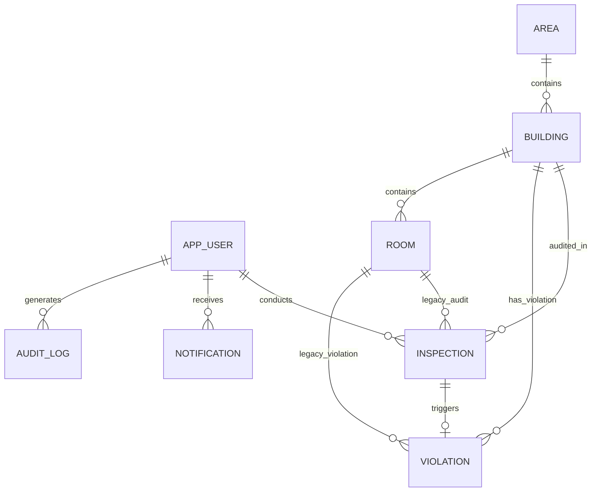

# WasteWatch — Database Design & Schema Specification

> **STATUS: FULLY IMPLEMENTED & SYNCHRONIZED (PHASES 1–14)**  
> *The relational schema, JPA entities, repositories, and constraints described below are actively running in `com.wastewatch.entity`, `com.wastewatch.repository`, and `com.wastewatch.config`. Database seeding occurs automatically on empty databases, and runtime migrations seamlessly adapt schema constraints.*

---

## 1. Overview & Persistence Strategy

WasteWatch implements an ANSI-SQL compliant relational database schema managed through **Spring Data JPA** and **Hibernate 6**.

- **Development & Local Evaluation Target**: File-based H2 database (`jdbc:h2:file:./data/wastewatchdb;DB_CLOSE_DELAY=-1`), stored at `backend/data/wastewatchdb.mv.db` when launched from `backend/`. All records survive application restarts.
- **Testing Target**: Isolated in-memory H2 database (`jdbc:h2:mem:wastewatchdb_test;DB_CLOSE_DELAY=-1`) configured in `backend/src/test/resources/application.yml`. Tests execute against a fresh, ephemeral schema and do not impact development data.
- **Schema Evolution**: The `dev` profile uses Hibernate `ddl-auto: update`, which preserves existing data while creating newly declared tables and columns.
- **Credentials**: Local database credentials are configurable via environment variables:
  - `WASTEWATCH_DB_USERNAME` (defaults to `sa`).
  - `WASTEWATCH_DB_PASSWORD` (defaults to empty string for new databases).
- **H2 Web Console**: Enabled exclusively in the `dev` profile at `http://localhost:8080/h2-console` with remote connections disabled (`web-allow-others: false`).
- **Production Portability**: Designed for zero-friction migration to **PostgreSQL 15+** or **MySQL 8+**:
  - Uses standard ANSI SQL datatypes and JPA annotations.
  - Table name `APP_USERS` avoids SQL reserved keywords across PostgreSQL, H2, and Oracle.
  - No database-specific triggers or stored procedures are used.

---

## 1.1. Local Database Backup & Restore

To ensure data integrity, always stop the backend before copying the database file:
1. **Backup**:
   ```powershell
   # From repository root (while backend process is stopped)
   Copy-Item .\backend\data\wastewatchdb.mv.db "$env:USERPROFILE\wastewatchdb-backup.mv.db"
   ```
2. **Restore**:
   Stop the backend, preserve a copy of the current file, copy the backup back to `backend\data\wastewatchdb.mv.db`, and restart the application.

> [!NOTE]
> The root `.gitignore` excludes `backend/data/`, all `*.mv.db` files, and `.env*` configuration files.

---

## 2. Entity-Relationship (ER) Model



### Architectural Relationship Rules:
1. **Primary Audit Target**: Inspections (`INSPECTIONS`) and Violations (`VIOLATIONS`) link directly to `BUILDINGS(id)`.
2. **Volunteer Assignment**: An inspection is conducted by an authenticated `APP_USERS(id)` with role `VOLUNTEER` and status `ACTIVE`.
3. **One-to-One Violation Escalation**: An inspection with a `POOR` score (<40) triggers at most one `VIOLATIONS` record, guaranteed by the `UNIQUE(inspection_id)` constraint.
4. **Backward Compatibility**: The `ROOMS` entity and references `INSPECTIONS(room_id)` and `VIOLATIONS(room_id)` are nullable and deprecated. Legacy records retain room associations while modern audits operate at the building level.

---

## 3. Runtime Table Specifications

### 3.1. `APP_USERS`
* **Purpose**: System accounts, authentication credentials, contact details, and role assignments.
* **Fields**:
  | Column Name | Data Type | Constraints | Description |
  | :--- | :--- | :--- | :--- |
  | `id` | `BIGINT` | `PRIMARY KEY, AUTO_INCREMENT` | Unique user identifier |
  | `username` | `VARCHAR(50)` | `NOT NULL, UNIQUE` | Login username |
  | `email` | `VARCHAR(100)`| `NOT NULL, UNIQUE` | Unique email address |
  | `password_hash` | `VARCHAR(255)`| `NOT NULL` | BCrypt salted hash (work factor 10) |
  | `full_name` | `VARCHAR(100)`| `NOT NULL` | Full display name |
  | `phone_number` | `VARCHAR(20)` | `NULLABLE` | Contact telephone number |
  | `city` | `VARCHAR(50)` | `NULLABLE` | Residential city (from volunteer registration) |
  | `state` | `VARCHAR(50)` | `NULLABLE` | Residential state (from volunteer registration) |
  | `address` | `VARCHAR(200)`| `NULLABLE` | Locality / housing society address |
  | `reason` | `VARCHAR(500)`| `NULLABLE` | Volunteer motivation statement |
  | `role` | `VARCHAR(20)` | `NOT NULL` | Enum: `ADMIN`, `VOLUNTEER` |
  | `status` | `VARCHAR(20)` | `NOT NULL, DEFAULT 'ACTIVE'`| Enum: `ACTIVE`, `INACTIVE`, `SUSPENDED`, `PENDING`, `REJECTED` |
  | `created_at` | `TIMESTAMP` | `NOT NULL, UP-TO-DATE` | Account registration timestamp |
  | `updated_at` | `TIMESTAMP` | `NOT NULL` | Last update timestamp |

---

### 3.2. `AREAS`
* **Purpose**: Municipal administrative wards, geographic sectors, or collection zones.
* **Fields**:
  | Column Name | Data Type | Constraints | Description |
  | :--- | :--- | :--- | :--- |
  | `id` | `BIGINT` | `PRIMARY KEY, AUTO_INCREMENT` | Unique area identifier |
  | `area_code` | `VARCHAR(20)` | `NOT NULL, UNIQUE` | Municipal zone code (e.g. `ZONE-NORTH-01`) |
  | `name` | `VARCHAR(100)`| `NOT NULL` | Descriptive name (e.g. "North Ward - Sector 14") |
  | `city` | `VARCHAR(100)`| `NOT NULL` | City name |
  | `pincode` | `VARCHAR(10)` | `NOT NULL` | Postal zip code |
  | `description` | `VARCHAR(255)`| `NULLABLE` | Sector boundaries or green initiative notes |
  | `status` | `VARCHAR(20)` | `NOT NULL, DEFAULT 'ACTIVE'`| Status code |
  | `created_at` | `TIMESTAMP` | `NOT NULL` | Creation timestamp |
  | `updated_at` | `TIMESTAMP` | `NOT NULL` | Last modification timestamp |

---

### 3.3. `BUILDINGS`
* **Purpose**: Physical housing societies, commercial IT parks, and apartment complexes.
* **Fields**:
  | Column Name | Data Type | Constraints | Description |
  | :--- | :--- | :--- | :--- |
  | `id` | `BIGINT` | `PRIMARY KEY, AUTO_INCREMENT` | Unique building identifier |
  | `area_id` | `BIGINT` | `NOT NULL, FOREIGN KEY` | References `AREAS(id)` |
  | `building_code`| `VARCHAR(30)` | `NOT NULL, UNIQUE` | Building code (e.g. `BLD-NW-101`) |
  | `name` | `VARCHAR(120)`| `NOT NULL` | Society or complex name (e.g. "Green Valley Heights") |
  | `address` | `VARCHAR(255)`| `NOT NULL` | Physical street address |
  | `latitude` | `DECIMAL(10,8)`| `NULLABLE` | GPS latitude for map pins ($-90.0 \le \text{lat} \le 90.0$) |
  | `longitude` | `DECIMAL(11,8)`| `NULLABLE` | GPS longitude for map pins ($-180.0 \le \text{lng} \le 180.0$) |
  | `building_type`| `VARCHAR(30)` | `NOT NULL, DEFAULT 'RESIDENTIAL'` | Enum: `RESIDENTIAL`, `COMMERCIAL`, `MIXED`, `INSTITUTIONAL` |
  | `total_floors` | `INT` | `NOT NULL, DEFAULT 1` | Floor count |
  | `status` | `VARCHAR(20)` | `NOT NULL, DEFAULT 'ACTIVE'`| Status code |
  | `created_at` | `TIMESTAMP` | `NOT NULL` | Creation timestamp |
  | `updated_at` | `TIMESTAMP` | `NOT NULL` | Last update timestamp |

---

### 3.4. `ROOMS` (Deprecated — Database Compatibility Only)
* **Purpose**: Individual flats, suites, or units. Retained for backwards compatibility with legacy audits.
* **Fields**:
  | Column Name | Data Type | Constraints | Description |
  | :--- | :--- | :--- | :--- |
  | `id` | `BIGINT` | `PRIMARY KEY, AUTO_INCREMENT` | Unique room identifier |
  | `building_id` | `BIGINT` | `NOT NULL, FOREIGN KEY` | References `BUILDINGS(id)` |
  | `floor_number`| `INT` | `NOT NULL` | Floor number |
  | `room_number` | `VARCHAR(30)` | `NOT NULL` | Flat or suite number (e.g. "Flat 101") |
  | `qr_code_token`| `VARCHAR(64)` | `NOT NULL, UNIQUE` | QR identifier (e.g. `QR-GVH-101`) |
  | `occupant_name`| `VARCHAR(100)`| `NULLABLE` | Occupant or business tenant name |
  | `contact_phone`| `VARCHAR(20)` | `NULLABLE` | Occupant contact phone number |
  | `status` | `VARCHAR(20)` | `NOT NULL, DEFAULT 'ACTIVE'`| Status code |
  | `persistent_non_compliance` | `BOOLEAN` | `NOT NULL, DEFAULT FALSE` | Flagged when $\ge 3$ consecutive audits fail |
  | `created_at` | `TIMESTAMP` | `NOT NULL` | Creation timestamp |
  | `updated_at` | `TIMESTAMP` | `NOT NULL` | Last modification timestamp |
* **Unique Constraint**: `UK_ROOMS_BUILDING_ROOM_NUM` on `(building_id, room_number)` prevents duplicate unit numbers within the same building.

---

### 3.5. `INSPECTIONS`
* **Purpose**: Field compliance audit records conducted by volunteers at the Building level.
* **Fields**:
  | Column Name | Data Type | Constraints | Description |
  | :--- | :--- | :--- | :--- |
  | `id` | `BIGINT` | `PRIMARY KEY, AUTO_INCREMENT` | Unique inspection ID |
  | `building_id`| `BIGINT` | `NOT NULL, FOREIGN KEY` | References `BUILDINGS(id)` (mandatory audit target) |
  | `room_id` | `BIGINT` | `NULLABLE, FOREIGN KEY` | References `ROOMS(id)` (deprecated; null for building audits) |
  | `volunteer_id`| `BIGINT` | `NOT NULL, FOREIGN KEY` | References `APP_USERS(id)` (authenticated volunteer) |
  | `inspection_date`| `TIMESTAMP` | `NOT NULL` | Timestamp of on-ground audit |
  | `wet_waste_separated` | `BOOLEAN` | `NOT NULL, DEFAULT FALSE` | Checklist Criterion 1 (25 pts) |
  | `dry_waste_separated` | `BOOLEAN` | `NOT NULL, DEFAULT FALSE` | Checklist Criterion 2 (25 pts) |
  | `sanitary_waste_separated`| `BOOLEAN`| `NOT NULL, DEFAULT FALSE` | Checklist Criterion 3 (20 pts) |
  | `correct_bins_used` | `BOOLEAN` | `NOT NULL, DEFAULT FALSE` | Checklist Criterion 4 (15 pts) |
  | `bins_labelled` | `BOOLEAN` | `NOT NULL, DEFAULT FALSE` | Checklist Criterion 5 (10 pts) |
  | `no_mixed_waste`| `BOOLEAN` | `NOT NULL, DEFAULT FALSE` | Checklist Criterion 6 (5 pts) |
  | `total_score` | `INT` | `NOT NULL, DEFAULT 0` | Calculated compliance score (0–100) |
  | `classification`| `VARCHAR(20)` | `NOT NULL` | Enum: `EXCELLENT`, `GOOD`, `NEEDS_IMPROVEMENT`, `POOR` |
  | `status` | `VARCHAR(20)` | `NOT NULL` | Enum: `COMPLETED`, `PENDING`, `FLAGGED` |
  | `remarks` | `TEXT` | `NULLABLE` | Volunteer auditor field notes |
  | `evidence_image_url` | `VARCHAR(255)`| `NULLABLE` | Optional photographic evidence URL |
  | `created_at` | `TIMESTAMP` | `NOT NULL` | Record creation timestamp |
  | `updated_at` | `TIMESTAMP` | `NOT NULL` | Record update timestamp |

---

### 3.6. `VIOLATIONS`
* **Purpose**: Non-compliance incident tickets automatically raised when an audit score falls below 40 (`POOR`).
* **Fields**:
  | Column Name | Data Type | Constraints | Description |
  | :--- | :--- | :--- | :--- |
  | `id` | `BIGINT` | `PRIMARY KEY, AUTO_INCREMENT` | Unique violation ticket ID |
  | `inspection_id`| `BIGINT` | `NOT NULL, UNIQUE, FOREIGN KEY`| References `INSPECTIONS(id)` (1-to-1 link) |
  | `building_id`| `BIGINT` | `NOT NULL, FOREIGN KEY` | References `BUILDINGS(id)` |
  | `room_id` | `BIGINT` | `NULLABLE, FOREIGN KEY` | References `ROOMS(id)` (deprecated/compatibility) |
  | `severity` | `VARCHAR(20)` | `NOT NULL, DEFAULT 'MEDIUM'` | Enum: `LOW`, `MEDIUM`, `HIGH`, `CRITICAL` |
  | `status` | `VARCHAR(20)` | `NOT NULL, DEFAULT 'OPEN'` | Enum: `OPEN`, `ACKNOWLEDGED`, `ACTION_REQUIRED`, `RESOLVED` |
  | `description` | `TEXT` | `NULLABLE` | Automated violation reason and score context |
  | `fine_amount` | `DECIMAL(10,2)`| `DEFAULT 0.00` | Assessed municipal fine (e.g. ₹500 CRITICAL, ₹250 HIGH) |
  | `resolution_notes`| `TEXT` | `NULLABLE` | Official notes entered upon resolution |
  | `created_at` | `TIMESTAMP` | `NOT NULL` | Ticket issue timestamp |
  | `resolved_at` | `TIMESTAMP` | `NULLABLE` | Resolution completion timestamp |

---

### 3.7. `NOTIFICATIONS`
* **Purpose**: In-app governance alerts and warnings for municipal administrators and volunteers.
* **Fields**:
  | Column Name | Data Type | Constraints | Description |
  | :--- | :--- | :--- | :--- |
  | `id` | `BIGINT` | `PRIMARY KEY, AUTO_INCREMENT` | Unique notification ID |
  | `user_id` | `BIGINT` | `NOT NULL, FOREIGN KEY` | References `APP_USERS(id)` (recipient) |
  | `title` | `VARCHAR(150)`| `NOT NULL` | Notification headline |
  | `message` | `TEXT` | `NOT NULL` | Detailed message body |
  | `notification_type`| `VARCHAR(30)` | `NOT NULL, DEFAULT 'SYSTEM'` | Enum: `INSPECTION_ASSIGNED`, `VIOLATION_RAISED`, `VIOLATION_SEVERITY_HIGH`, `PERSISTENT_NON_COMPLIANCE`, `COVERAGE_ALERT`, `SYSTEM` |
  | `is_read` | `BOOLEAN` | `NOT NULL, DEFAULT FALSE`| Read status flag |
  | `created_at` | `TIMESTAMP` | `NOT NULL` | Notification timestamp |

---

### 3.8. `AUDIT_LOGS`
* **Purpose**: Immutable security audit trail recording all administrative operations, lifecycle changes, and mutations.
* **Fields**:
  | Column Name | Data Type | Constraints | Description |
  | :--- | :--- | :--- | :--- |
  | `id` | `BIGINT` | `PRIMARY KEY, AUTO_INCREMENT` | Unique audit log ID |
  | `user_id` | `BIGINT` | `NULLABLE, FOREIGN KEY` | References `APP_USERS(id)` (actor) |
  | `action` | `VARCHAR(50)` | `NOT NULL` | Operation code (e.g. `USER_LOGIN`, `CREATE_AREA`, `CREATE_BUILDING`, `CREATE_INSPECTION`, `RESOLVE_VIOLATION`, `VOLUNTEER_STATUS_CHANGED`) |
  | `entity_type` | `VARCHAR(50)` | `NOT NULL` | Entity modified (`AppUser`, `Area`, `Building`, `Room`, `Inspection`, `Violation`) |
  | `entity_id` | `VARCHAR(50)` | `NULLABLE` | Primary key ID of the affected entity |
  | `ip_address` | `VARCHAR(45)` | `NULLABLE` | Client IP address |
  | `details` | `TEXT` | `NULLABLE` | Contextual operational description |
  | `created_at` | `TIMESTAMP` | `NOT NULL` | Immutable log timestamp |

---

## 4. Runtime Database Migration (`DatabaseMigration`)

To ensure smooth backwards compatibility with pre-existing H2 database files on disk without losing data or requiring manual SQL scripts, the backend executes an automatic migration runner (`@Order(1) CommandLineRunner`):

1. **Check Constraint Migration on `APP_USERS.STATUS`**:
   - Queries `INFORMATION_SCHEMA.CHECK_CONSTRAINTS` for constraints restricting `APP_USERS.STATUS` that lack `PENDING`.
   - Drops outdated constraints and installs `CHECK_APP_USERS_STATUS`:
     ```sql
     ALTER TABLE APP_USERS ADD CONSTRAINT CHECK_APP_USERS_STATUS 
       CHECK ("STATUS" IN ('ACTIVE', 'INACTIVE', 'SUSPENDED', 'PENDING', 'REJECTED'));
     ```
2. **Nullability Updates for Building-Level Architecture**:
   - Drops the `NOT NULL` constraint on `INSPECTIONS.ROOM_ID` to allow pure building audits.
   - Drops the `NOT NULL` constraint on `VIOLATIONS.ROOM_ID` to support building-level violations.
3. **Data Backfill for Legacy Records**:
   - Backfills `BUILDING_ID` on legacy `INSPECTIONS` and `VIOLATIONS` records from their corresponding `ROOMS.BUILDING_ID` association.

---

## 5. Database Indexes & Performance Optimization

| Index Name | Table | Columns | Purpose |
| :--- | :--- | :--- | :--- |
| `UK_APP_USERS_USERNAME` | `APP_USERS` | `username` (UNIQUE) | Fast credential authentication lookup |
| `UK_APP_USERS_EMAIL` | `APP_USERS` | `email` (UNIQUE) | Fast email uniqueness verification |
| `UK_AREAS_CODE` | `AREAS` | `area_code` (UNIQUE) | Fast area code resolution |
| `UK_BUILDINGS_CODE` | `BUILDINGS` | `building_code` (UNIQUE) | Fast building lookup by code |
| `IDX_BUILDINGS_AREA` | `BUILDINGS` | `area_id` | Fast filtering of buildings by area |
| `UK_ROOMS_BUILDING_ROOM_NUM` | `ROOMS` | `building_id, room_number` (UNIQUE) | Enforces unique units per building |
| `UK_ROOMS_QR_CODE` | `ROOMS` | `qr_code_token` (UNIQUE) | Fast token lookup via QR scanner |
| `IDX_INSPECTIONS_BUILDING` | `INSPECTIONS` | `building_id` | Fast building inspection history queries |
| `IDX_INSPECTIONS_VOLUNTEER`| `INSPECTIONS` | `volunteer_id` | Volunteer personal history query performance |
| `IDX_INSPECTIONS_DATE` | `INSPECTIONS` | `inspection_date DESC` | Recent inspections and time-series aggregation |
| `UK_VIOLATIONS_INSPECTION` | `VIOLATIONS` | `inspection_id` (UNIQUE) | Ensures 1:1 inspection-to-violation mapping |
| `IDX_VIOLATIONS_STATUS` | `VIOLATIONS` | `status` | Fast filtering by open/resolved status |
| `IDX_VIOLATIONS_BUILDING` | `VIOLATIONS` | `building_id` | Building-level violation aggregation |
| `IDX_NOTIFICATIONS_USER_READ`| `NOTIFICATIONS`| `user_id, is_read` | Fast unread badge counter queries |
| `IDX_AUDIT_LOGS_CREATED` | `AUDIT_LOGS` | `created_at DESC` | High-performance chronological audit trail sorting |
