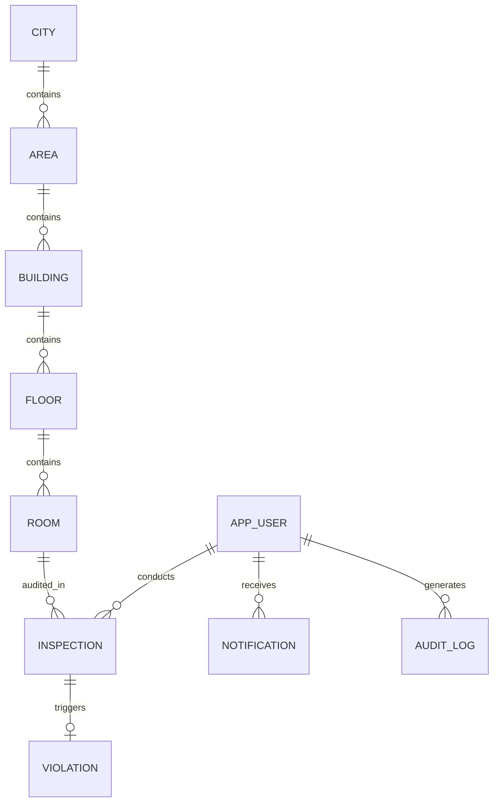

# WasteWatch — Database Design & Schema Specification

> **STATUS: IMPLEMENTED IN RUNTIME (PHASE 3)**  
> *The core relational schema and JPA entities described below are fully implemented in `com.wastewatch.entity`, backed by Spring Data JPA repositories in `com.wastewatch.repository`, and automatically created and seeded in H2 database upon application startup.*

---

## 1. Overview & Portability Strategy

WasteWatch uses a relational database design managed through Spring Data JPA / Hibernate.
- **Development & Academic Target**: H2 Database (file-persisted or in-memory mode) for zero-dependency local execution.
- **Production & SaaS Target**: PostgreSQL 15+ (or MySQL 8+).
- **Portability Rules**:
  - Strictly use ANSI-standard SQL conventions and JPA annotations.
  - Avoid proprietary H2 syntax or database-specific triggers/procedures.
  - Table and column names use uppercase snake_case (e.g., `APP_USERS`, `INSPECTIONS`, `CREATED_AT`).
  - Table name `APP_USERS` is used instead of `USERS` to avoid SQL keyword conflicts across PostgreSQL, H2, and Oracle.

---

## 2. Entity-Relationship (ER) Conceptual Model

---

## 3. Planned Table Specifications

### 3.1. `APP_USERS`
* **Purpose**: Stores authenticated credentials, personal details, and assigned roles for system users (Admins, Volunteers).
* **Fields**:
  | Column Name | Data Type | Constraints | Description |
  | :--- | :--- | :--- | :--- |
  | `id` | `BIGINT` | `PRIMARY KEY, AUTO_INCREMENT` | Unique user identifier |
  | `username` | `VARCHAR(50)` | `NOT NULL, UNIQUE` | Unique handle / login identifier |
  | `email` | `VARCHAR(100)`| `NOT NULL, UNIQUE` | Contact email address |
  | `password_hash` | `VARCHAR(255)`| `NOT NULL` | BCrypt encrypted password hash |
  | `full_name` | `VARCHAR(100)`| `NOT NULL` | Display name of the user |
  | `phone_number` | `VARCHAR(20)` | `NULLABLE` | Contact telephone number |
  | `role` | `VARCHAR(20)` | `NOT NULL` | Enum: `ADMIN`, `VOLUNTEER` |
  | `status` | `VARCHAR(20)` | `NOT NULL, DEFAULT 'ACTIVE'`| Enum: `ACTIVE`, `INACTIVE`, `SUSPENDED` |
  | `created_at` | `TIMESTAMP` | `NOT NULL` | Record creation timestamp |
  | `updated_at` | `TIMESTAMP` | `NOT NULL` | Last update timestamp |
* **Relationships**:
  - `1:N` with `INSPECTIONS` (a volunteer conducts zero or many inspections).
  - `1:N` with `NOTIFICATIONS` (a user receives zero or many notifications).
  - `1:N` with `AUDIT_LOGS` (a user triggers zero or many audit logs).
* **Future Considerations**: Support for Multi-Factor Authentication (MFA), external OAuth2/SSO providers, and multi-tenant organization IDs.

---

### 3.2. `AREAS`
* **Purpose**: Represents municipal zones, sectors, or neighborhoods within an urban jurisdiction.
* **Fields**:
  | Column Name | Data Type | Constraints | Description |
  | :--- | :--- | :--- | :--- |
  | `id` | `BIGINT` | `PRIMARY KEY, AUTO_INCREMENT` | Unique area identifier |
  | `area_code` | `VARCHAR(20)` | `NOT NULL, UNIQUE` | Short code (e.g., `ZONE-NORTH-01`) |
  | `name` | `VARCHAR(100)`| `NOT NULL` | Descriptive name (e.g., "Ward 14 - Green Hills") |
  | `city` | `VARCHAR(100)`| `NOT NULL` | Associated city name |
  | `pincode` | `VARCHAR(10)` | `NOT NULL` | Postal zip code |
  | `description` | `VARCHAR(255)`| `NULLABLE` | Administrative notes |
  | `created_at` | `TIMESTAMP` | `NOT NULL` | Record creation timestamp |
  | `updated_at` | `TIMESTAMP` | `NOT NULL` | Last update timestamp |
* **Relationships**:
  - `1:N` with `BUILDINGS` (an area contains one or many buildings).
* **Future Considerations**: Storing GeoJSON boundary polygons for spatial GIS analytics and zone health mapping.

---

### 3.3. `BUILDINGS`
* **Purpose**: Represents physical structures, residential complexes, societies, or commercial premises.
* **Fields**:
  | Column Name | Data Type | Constraints | Description |
  | :--- | :--- | :--- | :--- |
  | `id` | `BIGINT` | `PRIMARY KEY, AUTO_INCREMENT` | Unique building identifier |
  | `area_id` | `BIGINT` | `NOT NULL, FOREIGN KEY` | References `AREAS(id)` |
  | `building_code`| `VARCHAR(30)` | `NOT NULL, UNIQUE` | System code (e.g., `BLD-GH-101`) |
  | `name` | `VARCHAR(120)`| `NOT NULL` | Building or apartment society name |
  | `address` | `VARCHAR(255)`| `NOT NULL` | Street address |
  | `latitude` | `DECIMAL(10,8)`| `NULLABLE` | GPS latitude for map visualization |
  | `longitude` | `DECIMAL(11,8)`| `NULLABLE` | GPS longitude for map visualization |
  | `building_type`| `VARCHAR(30)` | `NOT NULL` | Enum: `RESIDENTIAL`, `COMMERCIAL`, `MIXED`, `INSTITUTIONAL` |
  | `total_floors` | `INT` | `NOT NULL, DEFAULT 1` | Floor count |
  | `created_at` | `TIMESTAMP` | `NOT NULL` | Record creation timestamp |
  | `updated_at` | `TIMESTAMP` | `NOT NULL` | Last update timestamp |
* **Relationships**:
  - `N:1` with `AREAS` (belongs to one area).
  - `1:N` with `FLOORS` / `ROOMS` (contains many floors and rooms).
* **Future Considerations**: Spatial indexing (PostGIS `GEOMETRY(Point, 4326)` when migrating to PostgreSQL) for ultra-fast radius queries.

---

### 3.4. `ROOMS`
* **Purpose**: The atomic audit unit representing an individual flat, apartment, office, or shop.
* **Fields**:
  | Column Name | Data Type | Constraints | Description |
  | :--- | :--- | :--- | :--- |
  | `id` | `BIGINT` | `PRIMARY KEY, AUTO_INCREMENT` | Unique room identifier |
  | `building_id` | `BIGINT` | `NOT NULL, FOREIGN KEY` | References `BUILDINGS(id)` |
  | `floor_number`| `INT` | `NOT NULL` | Floor level (e.g., 0 for Ground, 1, 2) |
  | `room_number` | `VARCHAR(30)` | `NOT NULL` | Unit identifier (e.g., "Flat 302", "Suite B") |
  | `qr_code_token`| `VARCHAR(64)` | `NOT NULL, UNIQUE` | Unique token embedded in room QR code |
  | `occupant_name`| `VARCHAR(100)`| `NULLABLE` | Primary occupant/tenant name |
  | `contact_phone`| `VARCHAR(20)` | `NULLABLE` | Occupant contact number |
  | `created_at` | `TIMESTAMP` | `NOT NULL` | Record creation timestamp |
  | `updated_at` | `TIMESTAMP` | `NOT NULL` | Last update timestamp |
* **Relationships**:
  - `N:1` with `BUILDINGS` (belongs to a building).
  - `1:N` with `INSPECTIONS` (audited across time).
* **Unique Key**: Composite unique constraint on `(building_id, room_number)`.
* **Future Considerations**: QR code asset regeneration, occupant consent/notification flags.

---

### 3.5. `INSPECTIONS`
* **Purpose**: Immutable historical record of an on-site waste segregation audit.
* **Fields**:
  | Column Name | Data Type | Constraints | Description |
  | :--- | :--- | :--- | :--- |
  | `id` | `BIGINT` | `PRIMARY KEY, AUTO_INCREMENT` | Unique inspection record ID |
  | `room_id` | `BIGINT` | `NOT NULL, FOREIGN KEY` | References `ROOMS(id)` |
  | `volunteer_id`| `BIGINT` | `NOT NULL, FOREIGN KEY` | References `APP_USERS(id)` |
  | `inspection_date`| `TIMESTAMP` | `NOT NULL` | Audit timestamp |
  | `wet_waste_separated` | `BOOLEAN` | `NOT NULL` | +25 points |
  | `dry_waste_separated` | `BOOLEAN` | `NOT NULL` | +25 points |
  | `sanitary_waste_separated` | `BOOLEAN`| `NOT NULL` | +20 points |
  | `correct_bins_used` | `BOOLEAN` | `NOT NULL` | +15 points |
  | `bins_labelled` | `BOOLEAN` | `NOT NULL` | +10 points |
  | `no_mixed_waste` | `BOOLEAN` | `NOT NULL` | +5 points |
  | `total_score` | `INT` | `NOT NULL` | Calculated score: 0 to 100 |
  | `classification` | `VARCHAR(20)` | `NOT NULL` | `EXCELLENT`, `GOOD`, `NEEDS_IMPROVEMENT`, `POOR` |
  | `remarks` | `TEXT` | `NULLABLE` | Volunteer notes/observations |
  | `evidence_image_url` | `VARCHAR(255)`| `NULLABLE` | Photo path or cloud storage URL |
  | `created_at` | `TIMESTAMP` | `NOT NULL` | Timestamp record logged |
* **Relationships**:
  - `N:1` with `ROOMS`.
  - `N:1` with `APP_USERS` (volunteer).
  - `1:1` (or `1:N`) with `VIOLATIONS` (optional linkage when compliance score fails thresholds).
* **Future Considerations**: Index on `(room_id, inspection_date DESC)` for fast historical lookups; database partition by year/month for historical scaling.

---

### 3.6. `VIOLATIONS`
* **Purpose**: Tracks non-compliant inspection events requiring corrective action or fine escalation.
* **Fields**:
  | Column Name | Data Type | Constraints | Description |
  | :--- | :--- | :--- | :--- |
  | `id` | `BIGINT` | `PRIMARY KEY, AUTO_INCREMENT` | Unique violation ID |
  | `inspection_id`| `BIGINT` | `NOT NULL, UNIQUE, FOREIGN KEY`| References `INSPECTIONS(id)` |
  | `severity` | `VARCHAR(20)` | `NOT NULL` | Enum: `LOW`, `MEDIUM`, `HIGH`, `CRITICAL` |
  | `status` | `VARCHAR(20)` | `NOT NULL, DEFAULT 'OPEN'` | Enum: `OPEN`, `NOTIFIED`, `RESOLVED`, `ESCALATED` |
  | `fine_amount` | `DECIMAL(10,2)`| `DEFAULT 0.00` | Optional penalty assessed |
  | `resolution_notes`| `TEXT` | `NULLABLE` | Notes upon verification of correction |
  | `resolved_at` | `TIMESTAMP` | `NULLABLE` | Timestamp when issue was closed |
  | `created_at` | `TIMESTAMP` | `NOT NULL` | Created timestamp |
* **Relationships**:
  - `1:1` with `INSPECTIONS`.
* **Future Considerations**: Escalation timelines with automated scheduled reminders.

---

### 3.7. `NOTIFICATIONS`
* **Purpose**: In-app alert queue for both administrators and volunteers.
* **Fields**:
  | Column Name | Data Type | Constraints | Description |
  | :--- | :--- | :--- | :--- |
  | `id` | `BIGINT` | `PRIMARY KEY, AUTO_INCREMENT` | Unique notification ID |
  | `user_id` | `BIGINT` | `NOT NULL, FOREIGN KEY` | References `APP_USERS(id)` |
  | `title` | `VARCHAR(150)`| `NOT NULL` | Alert headline |
  | `message` | `TEXT` | `NOT NULL` | Alert body |
  | `notification_type`| `VARCHAR(30)` | `NOT NULL` | Enum: `INSPECTION_ASSIGNED`, `VIOLATION_RAISED`, `SYSTEM` |
  | `is_read` | `BOOLEAN` | `NOT NULL, DEFAULT FALSE`| Read status |
  | `created_at` | `TIMESTAMP` | `NOT NULL` | Timestamp generated |
* **Relationships**:
  - `N:1` with `APP_USERS`.

---

### 3.8. `AUDIT_LOGS`
* **Purpose**: Immutable security audit trail recording critical platform operations.
* **Fields**:
  | Column Name | Data Type | Constraints | Description |
  | :--- | :--- | :--- | :--- |
  | `id` | `BIGINT` | `PRIMARY KEY, AUTO_INCREMENT` | Unique audit log ID |
  | `user_id` | `BIGINT` | `NULLABLE, FOREIGN KEY` | References `APP_USERS(id)` (null for system events) |
  | `action` | `VARCHAR(50)` | `NOT NULL` | Action code (e.g., `USER_LOGIN`, `SUBMIT_INSPECTION`, `DELETE_BUILDING`) |
  | `entity_type` | `VARCHAR(50)` | `NOT NULL` | Affected domain entity |
  | `entity_id` | `VARCHAR(50)` | `NULLABLE` | Identifier of affected record |
  | `ip_address` | `VARCHAR(45)` | `NULLABLE` | Client IPv4/IPv6 address |
  | `details` | `TEXT` | `NULLABLE` | JSON payload of modifications |
  | `created_at` | `TIMESTAMP` | `NOT NULL` | Event timestamp |
* **Future Considerations**: Write-only storage (append-only) to ensure tamper-proof audit trails.

---

## 4. Planned Indexes

To optimize query latency across dashboard aggregation and mobile audit queries:
- `IDX_AREAS_CODE` on `AREAS(area_code)`
- `IDX_BUILDINGS_AREA` on `BUILDINGS(area_id)`
- `IDX_ROOMS_BUILDING` on `ROOMS(building_id)`
- `IDX_ROOMS_QR` on `ROOMS(qr_code_token)`
- `IDX_INSPECTIONS_ROOM_DATE` on `INSPECTIONS(room_id, inspection_date DESC)`
- `IDX_INSPECTIONS_VOLUNTEER` on `INSPECTIONS(volunteer_id)`
- `IDX_VIOLATIONS_STATUS` on `VIOLATIONS(status)`
- `IDX_NOTIFICATIONS_USER_READ` on `NOTIFICATIONS(user_id, is_read)`
